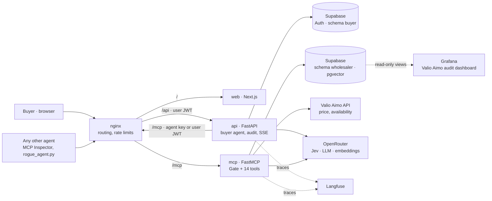

# Trusted Trade Agents

Junction 2026 · Valio Aimo track. A kitchen buyer tells a purchasing agent what they need ("lunch for 80 next Tuesday, nut-free"). The agent asks only what is missing, suggests dishes from what Valio Aimo has in stock, builds baskets and orders through **Valio Aimo's own MCP gateway**, which re-prices everything and decides whether the order is placed, held for approval or blocked.



| What | Where |
| --- | --- |
| Buyer app | http://localhost:8080 |
| Valio Aimo audit dashboard (Grafana) | http://localhost:3001 |
| MCP gateway | http://localhost:8080/mcp (see `docs/AGENT_INTEGRATION.md`) |
| Quote signing key | http://localhost:8080/.well-known/jwks.json |

## How a request runs

1. **Screen and understand, in parallel.** Jev scores whether the message is about purchasing; one LLM call turns it into a plan (products or a menu, people, date, allergens, diet). Off-topic messages are rejected before anything else happens.
2. **Ask, one question at a time.** Missing people, date or quantity become a multiple-choice question with a free-text field. Typed dates and quantities are read by code.
3. **Menus.** No dish named: the LLM suggests three, each checked against Valio Aimo's stock for the delivery day (coverage and cost per person shown). Recipes are computed while the buyer is still answering.
4. **Source.** The intent is signed with the buyer's own JWT (`register_intent`). The agent then makes one batched catalog search (`search_products_batch`) and one price and stock call (`get_price_availability`).
5. **Baskets in code.** Best match, cheapest, most reliable. Out of stock: another product, then the recipe's own alternative, then a partial fill with the earliest date it is available.
6. **Order within authority, ask otherwise.** A complete basket under the auto limit with no substitutes is ordered without asking (`AGENT_AUTO_ORDER=0` always asks). Otherwise the buyer picks a basket and the gateway decides: above the auto limit or with a substitute it is `held` until approved on the Approvals page; above the order limit or outside the mandate it is `blocked`.
7. **Trust.** Every quote is signed by Valio Aimo (Ed25519, public key at `/.well-known/jwks.json`) and valid for 15 minutes; the agent verifies it before using prices and stock. When stock is short the agent splits across several products, then uses Valio Aimo's own substitute pairs (always held for approval), then the recipe's alternative.

Every step streams to the browser as it happens (server-sent events).

## Install

You need: Docker Desktop, Python 3.12+ (for the setup scripts), a Supabase project (free tier works), an OpenRouter API key, the Valio Aimo API key (challenge PDF, page 5) and, optionally, a Langfuse project.

### 1. Get the code and the data

```bash
git clone https://github.com/buihin2007/TrustedTradeAgents-MathNet-.git
cd TrustedTradeAgents-MathNet-
```

Put the three challenge files in `data/` (never commit them):

```
data/valio_aimo_junction26_product_data*.json
data/valio_aimo_junction26_delivery_reliability.csv
data/valio_aimo_junction26_carbon_footprint.csv
```

### 2. Database (Supabase)

In the Supabase dashboard, **SQL Editor**, run these files in order:

1. `supabase/migrations/0001_init.sql`
2. `supabase/migrations/0002_audit_dashboard.sql`
3. `supabase/migrations/0003_import_fixes.sql`
4. `supabase/migrations/0005_demo_mandate.sql` (only on a project seeded before 15 Nov: raises the demo limits)

Then **Authentication → Users → Add user**: create the demo buyer (e.g. `manager@demo-hotel.example`, tick *Auto confirm*) and copy its UUID.

### 3. Agent key

The key must start with `tta_`. Generate it and its SHA-256:

```powershell
# PowerShell
$k = "tta_" + -join ((48..57)+(97..122) | Get-Random -Count 32 | % {[char]$_})
$h = -join ([Security.Cryptography.SHA256]::Create().ComputeHash([Text.Encoding]::UTF8.GetBytes($k)) | % { $_.ToString("x2") })
"AGENT_KEY=$k"; "hash: $h"
```

```bash
# bash
k="tta_$(openssl rand -hex 16)"; echo "AGENT_KEY=$k"; printf %s "$k" | sha256sum
```

### 4. Seed the demo organisation

Either with `psql`:

```bash
psql "$DATABASE_URL" -v user_id=<user-uuid> -v agent_key=<AGENT_KEY> -f supabase/seed.sql
```

or in the SQL Editor: open `supabase/seed.sql`, replace `:'user_id'::uuid` with `'<user-uuid>'::uuid` and `:'agent_key'` with `'<AGENT_KEY>'`, run it. To change the key later:

```sql
update wholesaler.agents set key_hash = '<hash>' where id = '00000000-0000-0000-0000-0000000000a1';
```

Give Grafana's read-only role a password (letters and digits):

```sql
alter role dashboard_ro with login password '<GRAFANA_DB_PASSWORD>';
```

### 5. `.env`

```bash
cp .env.example .env
```

| Variable | Where to find it |
| --- | --- |
| `NEXT_PUBLIC_SUPABASE_URL`, `SUPABASE_URL` | Project Settings → API → Project URL |
| `NEXT_PUBLIC_SUPABASE_PUBLISHABLE_KEY` | Project Settings → API Keys → publishable key (`sb_publishable_...`) |
| `SUPABASE_PROJECT_REF` | the 20 characters in the project URL |
| `DATABASE_URL` | Connect → **Session pooler** (port 5432). Password: letters and digits only |
| `GRAFANA_DB_HOST` | host part of `DATABASE_URL` |
| `GRAFANA_DB_PASSWORD`, `GRAFANA_ADMIN_PASSWORD` | the password from step 4, and one you choose |
| `OPENROUTER_API_KEY` | openrouter.ai → Keys |
| `VALIO_API_KEY` | challenge PDF; `VALIO_CUSTOMER=123` |
| `AGENT_KEY` | step 3 |
| `LANGFUSE_PUBLIC_KEY`, `LANGFUSE_SECRET_KEY` | optional, Langfuse → Settings → API keys. Nothing else is needed for tracing |
| `NEXT_PUBLIC_LANGFUSE_PROJECT_URL` | optional, `https://cloud.langfuse.com/project/<id>`: makes audit rows link to traces |

Check everything (prints no secrets):

```bash
python -m venv .venv && . .venv/bin/activate        # Windows: .venv\Scripts\Activate.ps1
pip install httpx "psycopg[binary]" python-dotenv fastmcp
python scripts/check_env.py
```

### 6. Import the catalog

About 17,500 products, with category labels (LLM) and `baai/bge-m3` embeddings, cached in `data/.cache/`:

```bash
python scripts/import/run.py              # or: docker compose run --rm import
python scripts/import/run.py --limit 200  # quick test first, if you like
```

Then run `supabase/migrations/0004_vector_index.sql` in the SQL Editor (HNSW index, 3 to 8 minutes on the free tier). Without it every search scans all embeddings and can hit the 2-second search timeout.

### 7. Start

```bash
docker compose up -d --build
```

Open http://localhost:8080 and sign in as the demo user. Grafana is on http://localhost:3001 (user `admin`).

After changing a `NEXT_PUBLIC_*` value: `docker compose up -d --build web`. After changing anything else in `.env`: `docker compose up -d api mcp`.

## Try it

| Message | What happens |
| --- | --- |
| `I need 1,000 litres of lactose-free milk by Monday` | The challenge's example: about 1,200 EUR, above the 300 EUR auto limit, so it is held; approve it on the Approvals page |
| `20 kg chicken fillet for Friday` | Under the auto limit and complete: ordered without asking |
| `Lunch for 80 people next Tuesday, nut-free` | Three dish suggestions checked against stock, nut allergens excluded at the gateway |
| `What should I cook for 100 guests on Saturday?` | Asks nothing it already knows, suggests dishes, "Suggest other dishes" if items are missing |
| `Salmon soup for 400` | The basket exceeds the 600 EUR order limit: the gateway blocks it |
| `hello how are you` | Rejected at once: not a purchasing request |

Demo scripts:

```bash
python scripts/rogue_agent.py      # a misbehaving agent: scraping, unrequested items, user-only tools, bursts. Expect 5/5 STOPPED
python scripts/diagnose.py         # why was the last request blocked or slow (gateway events with latency)
python scripts/valio_probe.py 2026-11-20 400104   # raw Valio price and availability answer
python scripts/demo/record_demo.py --rogue --grafana   # records the whole demo as a video (pip install playwright)
```

Fill the Grafana dashboard with sample traffic: run `scripts/demo/fake_gateway_events.sql` in the SQL Editor.

## Tests

```bash
cd services/mcp && uv run pytest        # gateway; MCP_TEST_DATABASE_URL=<empty local Postgres> enables DB tests
cd services/api && uv run pytest        # buyer agent; TEST_DATABASE_URL=<local Postgres, db name tta_api_test_*>
cd apps/web && npm ci && npx tsc --noEmit && npm run build
```

## Troubleshooting

| Symptom | Cause and fix |
| --- | --- |
| Every request ends in `FORBIDDEN` | `AGENT_KEY` does not start with `tta_` or its hash is not in `wholesaler.agents`: step 3 and 4. `python scripts/diagnose.py` tells which |
| "Gateway denied the operation", search slow | Migration 0004 is missing; or set `SEARCH_BATCH_VECTORS=0` |
| Everything "not in stock" | `python scripts/valio_probe.py <date> <product id>` shows Valio's raw answer; also check the order cut-off |
| Understanding takes long | Set `LLM_FAST_MODEL` to a faster OpenRouter model |
| No traces in Langfuse | `LANGFUSE_*` missing or wrong; remove stale `OTEL_EXPORTER_OTLP_*` lines from `.env`; restart `api mcp` |
| `max clients reached in session mode` | Several people share one Supabase project: each service keeps 2 connections, stop unused stacks |
| `error: externally-managed-environment` | Use the venv from step 5 |

## Repository

| Path | What |
| --- | --- |
| `apps/web` | Next.js buyer app: chat with live steps, approvals, mandate, audit |
| `services/api` | Buyer API and agent (`app/agent.py`, `brain.py` for LLM calls, `sourcing.py` for baskets) |
| `services/mcp` | Valio Aimo MCP gateway: Gate middleware, tools, order policy, search |
| `packages/contracts` | Shared Pydantic models: every request and response between `api` and `mcp` |
| `supabase` | Migrations and seed |
| `infra` | nginx and Grafana |
| `scripts` | Import, environment check, diagnosis, demo agents |
| `docs/AGENT_INTEGRATION.md` | How any external MCP agent buys through the gateway: identities, flow, signed quotes, reason codes, limits |
| `docs/PLAN.md` | Full plan (Vietnamese) |
| `CLAUDE.md` | Rules for anyone (human or AI) changing the code |

## Prototype shortcuts, and the path to production

- Mandates and intents are database records; the next step is a signed mandate (AP2-style).
- Both sides share one Supabase project so the gateway can verify the buyer's JWT; in production Valio Aimo would have its own identity for mandate signers.
- Orders are stored by the gateway because the challenge API has no ordering endpoint.
- Category names are LLM-derived (flagged `derived`); recipes and dish suggestions are LLM output, while quantities, prices, stock and every decision are computed in code and re-checked by the gateway.
- The live step stream is held in one `api` process; more than one `api` replica needs a shared channel (e.g. Postgres `LISTEN/NOTIFY`).
