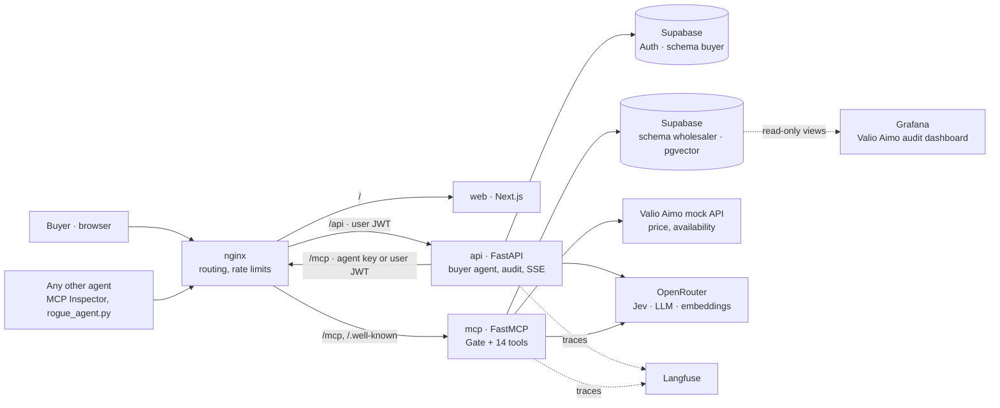

# Architecture, logic and requirement map

Valio Aimo owns an MCP gateway that any purchasing agent can use; our buyer app is one client of it. The LLM only reads requests and proposes recipes. Code decides quantities, products and baskets, and the gateway re-checks every number against Valio Aimo's data before it places, holds or blocks an order.

Install and run: [`README.md`](../README.md). External agents: [`AGENT_INTEGRATION.md`](AGENT_INTEGRATION.md). Code rules and owners: [`CLAUDE.md`](../CLAUDE.md).

## System



| Service | Side | Does | Code | Owner |
| --- | --- | --- | --- | --- |
| `web` | Buyer | Chat with live steps, questions, baskets; Approvals, Mandate, Audit pages | `apps/web` | P4, design UI-UX |
| `api` | Buyer | The purchasing agent, buyer audit log, REST and SSE for `web` | `services/api` | P3 |
| `mcp` | Valio Aimo | The gateway: Gate middleware, 14 tools, order policy, signed quotes | `services/mcp` | P2; search P1 |
| `nginx` | Shared | One entry point; rate limits 20 req/s per IP, 5 req/s per key | `infra/nginx` | P4 |
| Supabase | Shared | Postgres + pgvector + Auth; schema `buyer` and schema `wholesaler` | `supabase/` | P1 |
| Grafana | Valio Aimo | Live view of every agent call, from read-only views | `infra/grafana` | UI-UX / P2 |
| Langfuse | Both | Traces of every request, step, LLM call and gateway check | `tta_contracts/telemetry.py` | P3, P2 |
| Contracts | Shared | Pydantic models for every `api` ↔ `mcp` message, limits, tool table | `packages/contracts` | P1 |

Production would split the shared Supabase project in two: the gateway would not read the buyer's schema or trust the buyer's login provider directly (see [shortcuts](#prototype-shortcuts-and-the-path-to-production)).

## One request, step by step

```mermaid
sequenceDiagram
  actor Buyer
  participant API as api · agent
  participant LLM as OpenRouter
  participant GW as mcp · gateway
  Buyer->>API: "Lunch for 80 next Tuesday, nut-free"
  par screen and understand
    API->>LLM: Jev: is this a purchase request?
    API->>LLM: plan: dishes, people, date, must-nots
  end
  API-->>Buyer: one question at a time (people, date, dishes)
  Buyer->>API: answers
  API->>GW: register_intent (buyer's login)
  API->>GW: search_products_batch (agent key)
  API->>GW: get_price_availability
  GW-->>API: signed quote, valid 15 min
  API->>API: verify signature, build 3 baskets
  alt complete, no substitutes, under auto limit
    API->>GW: place_order
  else
    API-->>Buyer: pick a basket
    Buyer->>API: choice
    API->>GW: place_order
  end
  GW-->>API: placed / held / blocked + reasons
  API-->>Buyer: outcome; held orders go to Approvals
```

1. **Screen.** Jev (OpenRouter decisions, one question `purchase_request`) scores the first message. Below 0.2 it is rejected before any gateway call. It runs in parallel with step 2. `brain.py`
2. **Understand.** One LLM call returns a `Plan`: products or a menu, headcount, delivery date, allergens and diet. Unknown fields are dropped by sanitizers. `brain.py`, `agent.py: understand`
3. **Ask only what is missing.** Code picks the next question: headcount, quantity per item, delivery date, dishes (multi-select from stock), basket. Each has options plus free text. Typed dates and quantities are parsed in code; other free text goes back to the LLM to update the plan. `agent.py: advance`, `clarify.py`
4. **Source.** `register_intent` is signed with the buyer's own login, so the agent can only buy within that request. Then one batch search for every ingredient, one signed quote, and the agent verifies the signature with the gateway's JWKS. Short items: Valio Aimo's substitutes and a new quote. `agent.py: source`, `trust.py`
5. **Build baskets in code.** Best match, cheapest, most reliable; CO2, origin and delivery reliability per basket. `sourcing.py`
6. **Order or ask.** A complete basket with no substitutes and under the auto limit is ordered without asking (`AGENT_AUTO_ORDER=0` always asks). Otherwise the buyer picks. Either way the gateway decides. `agent.py: place`

Each step is one line in the chat's thinking box, one audit event, and one span in Langfuse. State lives in `buyer.requests.parsed` (`plan`, `feed`, `baskets`, `choice`, `order`); the browser gets whole snapshots over `GET /api/requests/{id}/stream`.

### When stock is short

The agent tries these in order and shows the trade-off before ordering:

1. Another product for the same ingredient.
2. Split the amount across several products.
3. Valio Aimo's own substitute pair (`get_substitutes`). The line carries `substitute_for`, so the gateway always holds the order for a person.
4. The recipe's own alternative ingredient.
5. Partial fill, with the reason and the earliest date it is available.

A delivery day with no stock at all, or past the order cut-off, sends the buyer back to the date question.

## The gateway (Gate)

Every tool call passes the Gate middleware (`services/mcp/app/gate.py`) before the tool runs.

| Token | Who | May call |
| --- | --- | --- |
| Agent key `tta_…` (only its SHA-256 is stored) | A purchasing agent | Read tools and `place_order` |
| Supabase login (JWT) | The person who signs the mandate | `register_intent`, approvals, mandate, agent pause |

Check order for one call:

1. nginx rate limits.
2. Authenticate the token: agent or person, organisation, current mandate.
3. Identity matrix: right kind of caller for this tool (`tta_contracts/tools.py`).
4. Agent paused?
5. Intent exists, belongs to the organisation, not expired (24 h).
6. Hard caps in code: 30 searches per batch, 50 ids per quote, 200 distinct products per intent, 4 options and 40 lines per order (`tta_contracts/limits.py`).
7. Only with `GATEWAY_JEV=1`: Jev per tool call, which can only make the outcome stricter.
8. `place_order` only: order policy, every total recomputed from the gateway's own prices.
9. Write one `gateway_events` row and one span.

| Outcome | When | Reason codes |
| --- | --- | --- |
| **placed** | Within the mandate | none |
| **held** for the signer | Above the auto limit, a substitute, partial stock, price moved beyond tolerance or an expired quote | `OVER_AUTO_LIMIT`, `SUBSTITUTION`, `PARTIAL_AVAILABILITY`, `PRICE_MOVED` |
| **blocked** | Breaks a must-have rule, above the per-order limit or the weekly budget, wrong pack size | `MUST_VIOLATED`, `OVER_ORDER_LIMIT`, `OVER_WEEKLY_BUDGET`, `LOT_SIZE` |
| refused call | Wrong identity, paused agent, bad intent, caps, rate | `FORBIDDEN`, `AGENT_PAUSED`, `INTENT_INVALID`, `CAP_EXCEEDED`, `RATE_LIMIT` |

The mandate is versioned and signed by the buyer: auto limit, per-order limit, weekly budget, price tolerance, whether substitutes are allowed. Demo values: 300 / 3,000 / 10,000 EUR. Approving a held order re-prices it at that moment.

## Trust protocol

- Prices and stock come only from the gateway, which calls the Valio Aimo API. An agent sends product ids and quantities, never prices.
- Each quote is signed with Ed25519 over canonical JSON (`tta_contracts.quote_signing_bytes`). The public key is at `/.well-known/jwks.json`; any agent can verify it.
- A quote is valid for 15 minutes. An order on an expired quote has no reference price, so it is held (`PRICE_MOVED`).
- Valio Aimo's availability schedule is read per Helsinki day; a passed order cut-off shows as `sales_block = "cutoff"`.

## Audit and traceability

| Record | Who reads it | Where |
| --- | --- | --- |
| Buyer audit trail: every decision, actor (agent, person, gateway, model), reason; append-only, hash-chained | The buyer | `buyer.audit_events`, Audit page |
| Gateway events: every tool call, decision, reasons, latency | Valio Aimo | `wholesaler.gateway_events`, Grafana |
| Traces | Both teams | Langfuse |

Langfuse model:

- **Session** = one buyer request (session id = request id, the UUID in `/requests/<id>`).
- **Trace** = one turn: `buyer request · start`, `buyer request · answer N`, `buyer decision · approve|reject`. A request with three questions has four traces, plus one for the decision.
- **Span** = one step (`step: …`), each LLM call (a generation with input and output), each gateway call (`mcp.<tool>`), and inside it the gateway's own `gate.call`, `gate.auth`, `gate.caps`. The gateway reads the W3C trace context from the MCP request, so both sides share one trace.
- Audit rows link to their turn's trace. `TRACE_CONTENT=0` keeps buyer wording out of traces.

## Data on Supabase

| Schema | Tables | Notes |
| --- | --- | --- |
| `buyer` | `profiles`, `requests`, `questions`, `request_options`, `audit_events` | Only `api` writes here |
| `wholesaler` | `products`, `product_substitutions`, `code_labels`, `orgs`, `org_members`, `agents`, `mandates`, `intents`, `quotes`, `orders`, `order_lines`, `gateway_events` | Only `mcp` writes here |
| `wholesaler` views | `v_product_search`, `v_audit_*` | Search, and Grafana's read-only role |

Search: Postgres full text plus pgvector (`baai/bge-m3`, 1024 dimensions, HNSW index), ranked together; filters and allergens are applied in SQL. If vector search is slow it falls back to full text for 10 minutes (`SEARCH_BATCH_VECTORS=0` turns vectors off).

## The challenge, mapped to features

Status: **Done** works in the demo; **Partial** works with a stated gap; **Not built** is a next step to name, not to show.

### Core requirements

| The brief asks for | What we built | Where | Status |
| --- | --- | --- | --- |
| Product, price and availability lookup in a structured way | MCP tools with JSON Schema: `search_products`, `search_products_batch`, `get_price_availability`, `get_facets` | `services/mcp/app/server.py`, `search/` | Done |
| From inquiry to commitment on fixed prices | Signed intent → signed quote → `place_order`; totals recomputed by the gateway | `server.py`, `orders.py` | Done |
| Permission and human-approval management | Signed, versioned mandate; placed / held / blocked; approve or reject by the signer only | `gate.py`, `policy.py`, web Mandate and Approvals | Done |

### Optional directions

| The brief asks for | What we built | Status |
| --- | --- | --- |
| Delivery time and sustainability | Delivery reliability per product, CO2 (category average), origin, shown per basket | Partial: certificates and labels (`claims`) are in search results but not shown on basket lines |
| Substitution and exceptions | The shortage ladder above; Valio Aimo substitute pairs always held | Done |
| Traceability and explainability | Buyer audit trail, Grafana for Valio Aimo, Langfuse sessions | Done |

### The four problems they want tackled

| Problem | Our answer |
| --- | --- |
| Trust protocol | Ed25519-signed quotes with a public JWKS, 15-minute validity; the gateway is the only source of prices and stock |
| Guardrails model | Mandate thresholds and order policy in code; substitutes and partial stock always need a person |
| Response logic | Good-better-best baskets within Valio Aimo's assortment, then split, substitute, recipe alternative, earliest date |
| Audit trail | Buyer audit (hash-chained) and the gateway's own log, linked by one trace id |

### Example scenarios

| Scenario | Status | Note |
| --- | --- | --- |
| Need → recipe → order | Done | Dishes suggested from stock on the delivery day, cost per person |
| Last-minute event | Done | Cut-off detection, recipe alternatives, missing items with the earliest date |
| Allergen-safe substitution | Partial | Allergens in the signed intent are enforced on every search and order line; nutrition rules are not modelled |
| Supplier stock-out mid-week | Not built | Needs re-checking placed orders and an alert |
| Proactive selling agent | Not built | Would be a Valio Aimo agent using the same gateway |
| Standing order drift detection | Not built | Needs order history per kitchen |

### Judging criteria

| Criterion | Weight | Our evidence |
| --- | --- | --- |
| Working end-to-end demo | 30% | Request → questions → lookup → order or approval, recorded by `scripts/demo/record_demo.py` |
| Solving the user need | 20% | Asks only for what is missing; small complete orders need no clicks |
| Autonomy and controls | 20% | Mandate, held vs blocked, rogue agent stopped 5/5, audit on both sides |
| Robustness to exceptions | 15% | Shortage ladder, cut-off, earliest date |
| Openness and path to production | 15% | MCP, JSON Schema, Ed25519 + JWKS, W3C trace context; shortcuts listed below |

## Prototype shortcuts, and the path to production

| Shortcut now | Production step |
| --- | --- |
| Buyer and gateway share one Supabase project, so the gateway verifies the buyer's login directly | Valio Aimo issues its own credentials to mandate signers, or verifies a signed mandate (AP2-style, verifiable credentials) |
| Agent keys are created by hand | Self-service agent registration per buyer organisation; scoped, revocable keys |
| The quote signing key is generated at start-up unless `GATEWAY_SIGNING_KEY` is set | Managed key with rotation; old keys stay in the JWKS until their quotes expire |
| Orders are stored by the gateway: the mock API has no ordering endpoint | The gateway places orders in Valio Aimo's order system; the interface stays the same |
| Category labels and recipes come from an LLM | Labels flagged as derived; recipes are proposals the buyer confirms |
| CO2 is a category-level average | Product-level footprint when Valio Aimo publishes it |
| Live step stream kept in one `api` process | A shared channel (Postgres `LISTEN/NOTIFY`) for more than one replica |

## Open work for the team

| Item | Why it matters | Owner |
| --- | --- | --- |
| Rehearse `record_demo.py` against the real login and data | 30% of the score is the end-to-end demo | P4 |
| Test a Valio Aimo substitute end to end with real catalog data | Exception handling is 15%; only covered by unit tests so far | P3 with P1 |
| Show certificates and labels (`claims`) on basket lines | Closes the "Partial" on sustainability | P3 (data) + P4 (web) |
| Return the agent's paused or active status from the API | The Mandate page only tracks it locally | P3 |
| Set `GATEWAY_SIGNING_KEY` in the shared `.env` | The public key stays the same across restarts | P2 |
| Rotate any key ever pasted into a chat before the repository goes public | Langfuse, OpenRouter and Valio keys | P4 |
| Keep scenario names in the talk: stock-out alerts, proactive selling, standing-order drift | Credible next steps (15%) | Everyone |
