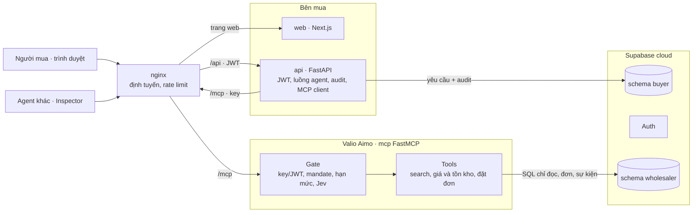

# Trusted Trade Agents: kế hoạch phát triển

Nov 15, 2026 · @ikm

Plan này đưa team 4 người từ repo rỗng đến một prototype chạy bằng docker compose trong 8 đến 14 giờ: app đăng nhập cho người mua (Next.js + FastAPI) chạy trên MCP server của Valio Aimo (FastMCP), có gate dùng Jev, search hybrid do LLM sinh SQL, audit log và trace.

## Quyết định đã chốt

Mười một lựa chọn đầu đến từ buổi grill; năm dòng cuối là mặc định mình đặt, đổi được bằng một comment.

| Hạng mục | Chốt | Nguồn |
| --- | --- | --- |
| Thời gian | Còn 8 đến 14 giờ; làm đủ feature, chỉ sắp thứ tự build | Grill |
| Cách code | 100% AI viết code; plan này là spec để mỗi người giao cho AI | Grill |
| Nơi chạy | Docker compose trên máy; Supabase dùng cloud | Grill |
| Người dùng app | Một vai: người mua (F&B manager). Không có trang admin | Yêu cầu |
| Search: ai viết SQL | LLM sinh SQL từ criteria; prompt chỉ chứa phần schema cần thiết | Grill |
| Search: bảo vệ | 4 lớp: role chỉ đọc trên 1 view, parser, timeout 2 giây, kiểm lại kết quả theo điều kiện cứng | Grill |
| Search: khớp tên | Hybrid ngay từ đầu: full-text + vector, gộp điểm RRF | Grill |
| Agent | Luồng cố định hoàn toàn; LLM chỉ đọc yêu cầu và viết lời giải thích | Grill |
| Gate | Jev validate từng tool call; luật số do code kiểm; Jev chỉ làm quyết định chặt hơn | Grill |
| Duyệt đơn | Cổng MCP giữ đơn ở trạng thái held; chỉ mở bằng JWT Supabase của người dùng | Grill |
| Hạn sử dụng | Không làm | Grill |
| Tách dữ liệu | 1 project Supabase, 2 schema: `buyer` và `wholesaler` | Mặc định |
| Intent | Yêu cầu gốc được đăng ký tại cổng kèm JWT người dùng; agent chỉ tham chiếu `intent_id` | Mặc định |
| Mandate | Seed sẵn 1 bản; người dùng sửa được hạn mức trên UI | Mặc định |
| Trace | OpenTelemetry gửi về Langfuse, kèm bảng `gateway_events` trong Postgres | Mặc định |
| Agent thứ hai khi demo | MCP Inspector và một script agent "hư" | Mặc định |

## Kiến trúc

Hệ thống có hai phía và một cửa nối chúng. Bên mua chạy `web` và `api`. Valio Aimo chạy `mcp`. Agent chỉ có một đường vào dữ liệu Valio Aimo: `/mcp`.



Hình chỉ vẽ đường đi của request. Bảng dưới liệt kê đủ thành phần, kể cả dịch vụ ngoài.

| Thành phần | Công nghệ | Việc phải làm | Gọi ra ngoài |
| --- | --- | --- | --- |
| `nginx` | nginx | Định tuyến `/`, `/api/`, `/mcp`; rate limit theo IP và theo key | Không |
| `web` | Next.js 16, `@supabase/ssr` | Đăng nhập; 6 trang của người mua | Supabase Auth |
| `api` | FastAPI | Kiểm JWT; chạy luồng agent; ghi audit; làm MCP client | OpenRouter (LLM đọc yêu cầu, viết giải thích) |
| `mcp` | FastMCP | Gate; 13 tool; giữ đơn; ghi nhật ký cổng | OpenRouter (Jev, embeddings, LLM sinh SQL); API giả của đề |
| Supabase | Auth, Postgres, pgvector | Người dùng; schema `buyer`; schema `wholesaler` | Không |
| Langfuse | OTLP qua HTTP | Nhận trace từ `api` và `mcp` | Không |

Ba ranh giới tin cậy phải giữ đúng khi code:

1. `api` không bao giờ đọc schema `wholesaler`. Mọi thứ đi qua tool.
2. `mcp` không tin số liệu agent gửi lên. Giá, tồn kho, tổng tiền đều do cổng tự tính lại.
3. Tool của người (đăng ký intent, duyệt đơn, sửa mandate) chỉ chạy khi token là JWT Supabase của người đó. Agent key gọi vào sẽ bị chặn.

Lối tắt của prototype: hai phía dùng chung một project Supabase, nên cổng kiểm được JWT của người mua. Ngoài đời Valio Aimo sẽ có danh tính riêng cho người ký mandate.

## Repo và cách 4 người vibe code song song

Bốn người cùng để AI viết code thì rủi ro lớn nhất là bốn AI tự đoán giao diện của nhau. Cách chặn: chốt hợp đồng trước, chia thư mục theo người, merge sớm và thường xuyên.

### Cấu trúc monorepo

```text
apps/web/                 Next.js (P4)
services/api/             FastAPI bên mua (P3)
services/mcp/             FastMCP, cổng Valio Aimo (P2)
  search/                 lớp search (P1)
packages/contracts/       Pydantic model dùng chung (P1 giữ, mọi người đọc)
supabase/migrations/      SQL đánh số 0001_, 0002_ (chỉ P1 merge)
scripts/import/           nhập dữ liệu đề cho (P1)
scripts/rogue_agent.py    agent hư để demo (P4)
infra/nginx/nginx.conf    (P4)
docker-compose.yml  .env.example  CLAUDE.md  README.md
data/                     file dữ liệu đề cho, nằm trong .gitignore
```

### Luật làm việc

1. Hợp đồng trước, code sau. Phase 0 chốt `packages/contracts` và chữ ký tool. Sau đó ai đổi hợp đồng phải báo cả nhóm.
2. Mỗi người chỉ sửa thư mục của mình. Cần đổi chỗ khác thì nhờ chủ thư mục.
3. Nhánh ngắn, ví dụ `p2/gate-policy`, sống dưới 90 phút. Rebase lên `main` trước khi mở PR.
4. `main` luôn chạy được bằng `docker compose up --build`. PR làm hỏng lệnh này thì revert ngay.
5. Một người giữ migration. Người khác gửi SQL cho P1, không tự thêm file.
6. Không commit secret và không commit `data/`. File sản phẩm nặng 87 MB, sát trần 100 MB mỗi file của GitHub.
7. Khoá phiên bản ngay Phase 0 bằng `uv.lock` và `pnpm-lock.yaml`. Không nâng cấp thư viện giữa chừng.

### CLAUDE.md ở gốc repo

Đây là file mọi AI coding agent đọc đầu tiên. Nội dung tối thiểu:

- Sơ đồ thư mục và ai giữ thư mục nào.
- Lệnh chạy, test, lint cho từng service.
- Ba ranh giới tin cậy ở phần Kiến trúc.
- Luật: không sửa `packages/contracts` và `supabase/migrations` nếu không được giao.
- Link tài liệu phải đọc trước khi dùng thư viện mới. Danh sách nằm ở cuối doc này.

### Mẫu giao việc cho AI

Mỗi task dán đúng ba thứ: mục tương ứng trong plan này, file hợp đồng liên quan, tiêu chí xong.

Ví dụ tiêu chí xong của P2: `pytest services/mcp/tests/test_policy.py` xanh, và `place_order` 360 EUR trả về `held` với lý do `OVER_AUTO_LIMIT`.

## Dữ liệu trên Supabase

### Thiết lập một lần

1. Bật extension `vector` và `pg_trgm`.
2. Tạo hai schema `buyer` và `wholesaler`. Không thêm chúng vào danh sách schema của Data API. Trình duyệt chỉ dùng Supabase Auth.
3. Lấy chuỗi kết nối loại Session pooler, cổng 5432. Kết nối trực tiếp chạy trên IPv6, container Docker thường không ra được.
4. Tạo role `search_ro` không đăng nhập được. Role này chỉ thấy đúng một view và một hàm.

### Bảng

| Schema.bảng | Chứa gì | Ai ghi |
| --- | --- | --- |
| `wholesaler.products` | 17.546 sản phẩm đã làm phẳng, có cột `fts` và `embedding` | Script import |
| `wholesaler.product_substitutions` | Cặp sản phẩm thay thế. Chỉ 189 sản phẩm có dữ liệu | Script import |
| `wholesaler.code_labels` | Tên cho mã category, đơn vị, nhiệt độ; cờ `derived` | Script import |
| `wholesaler.orgs`, `agents`, `mandates` | Khách hàng, key của agent (lưu hash), hạn mức đã ký | Seed, `mcp` |
| `wholesaler.intents` | Yêu cầu gốc do người đăng ký, kèm `user_id` | `mcp` |
| `wholesaler.orders`, `order_lines` | Đơn `placed`, `held`, `blocked`, `rejected` | `mcp` |
| `wholesaler.gateway_events` | Mỗi tool call một dòng: quyết định, lý do, SQL, trace | `mcp` |
| `buyer.profiles` | Người dùng thuộc tổ chức nào | Seed |
| `buyer.requests`, `request_options`, `questions` | Yêu cầu, các phương án, câu hỏi cho người dùng | `api` |
| `buyer.audit_events` | Nhật ký quyết định của agent, chỉ thêm | `api` |

### View cho search

`wholesaler.v_product_search` là thứ duy nhất LLM sinh SQL được biết. Giữ dưới 20 cột:

`product_id`, `name_en`, `name_fi`, `brand`, `vendor_name`, `category_code`, `category_name`, `sales_unit`, `unit_volume_l`, `unit_weight_kg`, `allowed_lot_size`, `temperature_condition`, `country_of_origin`, `claims`, `allergens_contains`, `labels`, `delivery_reliability`, `co2_kg_per_kg`, `has_substitutes`.

View lọc sẵn `deleted = false`. Ba cột `claims`, `allergens_contains`, `labels` là mảng text.

### Comment là một phần của schema

Mọi bảng và mọi cột đều có `COMMENT ON`. Comment của view search là nguồn sinh prompt cho LLM, nên viết như viết cho người mới: nghĩa, đơn vị, giá trị hợp lệ.

```sql
comment on column wholesaler.v_product_search.unit_volume_l is
  'Thể tích của 1 đơn vị bán (sales_unit), tính bằng lít. NULL nếu sản phẩm không bán theo thể tích.';
comment on column wholesaler.v_product_search.claims is
  'Mã nutritionalClaim của nhà sản xuất, ví dụ FREE_FROM_LACTOSE, FREE_FROM_GLUTEN, VEGAN.';
```

### Quyền của role search

```sql
create role search_ro nologin;
grant usage on schema wholesaler to search_ro;
grant select on wholesaler.v_product_search to search_ro;
grant execute on function wholesaler.hybrid_rank(text, text, int) to search_ro;
grant search_ro to postgres;
```

### Script import, chạy một lần

1. Đọc file JSON sản phẩm theo luồng bằng `ijson`.
2. Làm phẳng: tên theo 3 ngôn ngữ, brand, GTIN, claims, allergens, labels, thành phần.
3. Tính `unit_volume_l` và `unit_weight_kg` cho đơn vị bán từ `unitConversions`. Thiếu thì bắt số trong tên, ví dụ "1 l" hoặc "500 g", và gắn cờ `size_derived`.
4. Gộp hai file CSV: độ tin cậy giao hàng (4.425 dòng) và CO2 (11.033 dòng). Thiếu thì để NULL, không điền số giả.
5. Sinh tên cho 349 mã category bằng LLM, mỗi mã đưa 20 tên sản phẩm mẫu. Ghi `derived = true`.
6. Tạo `search_text`, gọi embeddings theo lô 100 dòng, ghi vào `embedding`.
7. Tạo index GIN cho `fts` và cho `claims`. Không tạo index vector, lý do nằm ở phần search.

Seed đi kèm: 1 tổ chức, 1 người dùng demo, 1 agent, 1 mandate.

## MCP server và lớp search

### Danh sách tool

| Tool | Ai gọi được | Việc | Trần cứng |
| --- | --- | --- | --- |
| `register_intent` | Người (JWT) | Lưu yêu cầu gốc, trả `intent_id` | Intent sống 24 giờ |
| `get_facets` | Agent | Trả từ vựng hợp lệ: claims, category, nhiệt độ, đơn vị | Cache 10 phút |
| `search_products` | Agent | Criteria vào, tối đa 50 sản phẩm ra | 200 sản phẩm khác nhau mỗi intent |
| `get_price_availability` | Agent | Giá và tồn kho theo ngày giao | 50 mã mỗi lần gọi |
| `get_substitutes` | Agent | Sản phẩm thay thế vẫn đạt điều kiện cứng | 10 mã mỗi lần gọi |
| `place_order` | Agent | Gửi 1 đến 4 phương án, nhận `placed`, `held` hoặc `blocked` | Bắt buộc `idempotency_key` |
| `get_order` | Agent, người | Trạng thái đơn và lý do | Chỉ đơn của tổ chức mình |
| `approve_order`, `reject_order` | Người (JWT) | Chọn một phương án của đơn `held`, hoặc từ chối | Cổng kiểm lại giá và tồn kho |
| `get_mandate`, `update_mandate` | Người (JWT) | Xem và sửa hạn mức | Mỗi lần sửa tạo version mới |
| `set_agent_status` | Người (JWT) | Tạm dừng hoặc mở lại agent | Có hiệu lực ngay |
| `list_gateway_events` | Người (JWT) | Đọc nhật ký cổng của tổ chức mình | 100 dòng mỗi trang |

API giả của đề không có endpoint đặt hàng. Đơn được lưu trong `wholesaler.orders`, và bản demo phải nói rõ điều này.

### Structured hay hybrid: dùng cả hai, mỗi thứ một việc

| Phương pháp | Mạnh | Yếu | Vai trò trong plan |
| --- | --- | --- | --- |
| Criteria có cấu trúc | Điều kiện cứng đúng tuyệt đối: không lactose, cỡ gói | Không hiểu tên gọi mơ hồ | Lọc. Đây là hợp đồng của tool |
| Hybrid: full-text + vector | Khớp tên qua 3 ngôn ngữ và từ đồng nghĩa | Không bảo đảm được điều kiện cứng | Xếp hạng bên trong tập đã lọc |
| Text-to-SQL tự do | Linh hoạt nhất | Khó kiểm soát, dễ thành quét cả bảng | Không dùng |
| LLM sinh SQL từ criteria, giá trị là bind parameter | Linh hoạt về hình dạng truy vấn, giá trị không lọt vào câu SQL | Cần rào bảo vệ | Cách ghép hai lớp trên |

Criteria quyết định sản phẩm nào được phép. Hybrid quyết định thứ tự. Giá và tồn kho không nằm trong SQL, vì chúng đến từ API theo khách và theo ngày giao.

### Hợp đồng criteria

```json
{
  "query_text": "lactose free milk 1 l",
  "query_text_alt": "laktoositon maito 1 l",
  "must": {
    "claims_all": ["FREE_FROM_LACTOSE"],
    "allergens_none": [],
    "category_codes": ["10400"],
    "unit_volume_l": {"min": 0.9, "max": 1.1},
    "temperature": null,
    "vendor_names": null
  },
  "prefer": {"brands": ["Valio"], "sort": "relevance"},
  "limit": 20
}
```

- `must` là điều kiện cứng. Cổng không bao giờ tự nới.
- `prefer` chỉ ảnh hưởng thứ tự.
- Mọi mã phải có trong `get_facets`. Mã lạ bị từ chối trước khi gọi LLM.
- `query_text_alt` là bản tiếng Phần Lan do LLM bên mua dịch. Tên sản phẩm có 3 ngôn ngữ nên bước này tăng độ khớp với chi phí rất nhỏ.

### Luồng xử lý của `search_products`

1. Validate criteria bằng Pydantic và từ vựng facets.
2. Đường tắt: `query_text` là 8 đến 14 chữ số thì tra thẳng GTIN, bỏ qua LLM.
3. Tính hình dạng của criteria: tập các trường có giá trị, cộng kiểu sort. Giá trị không thuộc hình dạng.
4. Tra cache SQL theo hình dạng. Trúng thì nhảy tới bước 7.
5. Gọi LLM sinh SQL.
6. Kiểm SQL bằng parser. Sai thì gọi lại 1 lần kèm thông báo lỗi. Vẫn sai thì dùng template viết tay.
7. Gọi embeddings một lần cho chuỗi ghép `query_text` và `query_text_alt`, cùng model với lúc import.
8. Chạy SQL bằng role `search_ro`, giao dịch chỉ đọc, timeout 2 giây.
9. Code kiểm lại từng dòng theo `must`. Có dòng sai thì loại dòng đó và xoá SQL của hình dạng này khỏi cache.
10. Trả kết quả kèm `query_id`. Ghi SQL, số dòng, thời gian vào `gateway_events`.

Sau vài yêu cầu đầu, hầu hết hình dạng đã nằm trong cache. LLM gần như không còn bị gọi, nên search nhanh và ổn định khi demo.

### Prompt sinh SQL: đúng, đủ, không thừa

- Đúng: thẻ schema được sinh từ `COMMENT ON` của view lúc service khởi động. Không ai chép tay.
- Đủ: mỗi tham số có tên, kiểu và nghĩa, ví dụ `:claims_all text[]`.
- Không thừa: LLM không nhận giá trị thật, không nhận câu yêu cầu gốc, không nhận cột mà criteria không dùng tới.

Luật ghi trong prompt:

1. Chỉ một câu `SELECT`. Chỉ đọc `wholesaler.v_product_search` và `wholesaler.hybrid_rank`.
2. Giá trị chỉ xuất hiện dưới dạng `:tên_tham_số`. Không viết hằng số.
3. Mỗi trường trong `must` thành đúng một điều kiện nối bằng `AND`.
4. Tham số mảng luôn bọc `CAST(:x AS text[])`.
5. Luôn kết thúc bằng `LIMIT :limit`.
6. Trả về JSON có đúng một khoá `sql`.

SQL mong đợi cho criteria ở trên:

```sql
select p.product_id, p.name_en, p.brand, p.sales_unit, p.unit_volume_l,
       p.claims, p.delivery_reliability, h.rrf_score
from wholesaler.v_product_search p
join wholesaler.hybrid_rank(:q_text, :q_emb, :k) h on h.product_id = p.product_id
where p.claims @> cast(:claims_all as text[])
  and p.category_code = any(cast(:category_codes as text[]))
  and p.unit_volume_l between :unit_volume_min and :unit_volume_max
order by h.rrf_score desc
limit :limit
```

### Hàm hybrid

Điểm gộp theo Reciprocal Rank Fusion:

```text
score(d) = 1 / (k + rank_fts(d)) + 1 / (k + rank_vec(d))
```

- `rank_fts(d)`: thứ hạng của sản phẩm d trong nhánh full-text.
- `rank_vec(d)`: thứ hạng của d trong nhánh vector.
- `k`: hằng số làm mượt, đặt 50 như ví dụ của Supabase.

| Sản phẩm | Hạng full-text | Hạng vector | Điểm |
| --- | --- | --- | --- |
| A | 1 | 3 | 1/51 + 1/53 = 0,0385 |
| B | Không khớp | 1 | 1/51 = 0,0196 |

Bản nháp của hàm. P1 chạy thử 5 truy vấn thật trước khi khoá.

```sql
create or replace function wholesaler.hybrid_rank(q_text text, q_emb text, k int default 300)
returns table (product_id int, rrf_score float8)
language sql stable security definer
set search_path = wholesaler, extensions
as $$
  with q as (
    select to_tsquery('simple', array_to_string(
      tsvector_to_array(to_tsvector('simple', q_text)), ' | ')) as tsq
  ), fts as (
    select p.id, row_number() over (order by ts_rank_cd(p.fts, q.tsq) desc) as r
    from products p, q
    where p.fts @@ q.tsq
    order by r limit k
  ), vec as (
    select s.id, row_number() over (order by s.dist) as r
    from (select p.id, p.embedding <=> q_emb::vector as dist
          from products p order by dist limit k) s
  )
  select coalesce(fts.id, vec.id)::int,
         (coalesce(1.0 / (50 + fts.r), 0) + coalesce(1.0 / (50 + vec.r), 0))::float8
  from fts full outer join vec on fts.id = vec.id
$$;
```

Ba điểm cần biết:

1. Nhánh full-text nối các từ bằng OR rồi xếp theo `ts_rank_cd`. Nối bằng AND sẽ bỏ sót sản phẩm tên `Milkdrink 1L` khi người dùng gõ `milk 1 l`. Nhánh vector bù phần còn lại.
2. `q_emb` nhận chuỗi dạng `[0.1,0.2,...]` rồi tự ép kiểu. Driver Python không cần biết kiểu vector.
3. Không tạo index vector. Với 17.546 dòng, quét chính xác là đủ. Index HNSW mặc định chỉ trả 40 dòng mỗi truy vấn (`hnsw.ef_search`), ít hơn `k`.

### Bốn lớp rào

| Lớp | Chặn cái gì | Cách làm |
| --- | --- | --- |
| 1. Quyền DB | Đọc bảng khác, ghi dữ liệu | `SET LOCAL ROLE search_ro` trong giao dịch `READ ONLY` |
| 2. Parser | Nhiều câu lệnh, bảng lạ, hàm lạ, thiếu `LIMIT`, hằng số | `sqlglot` duyệt cây cú pháp theo danh sách trắng |
| 3. Timeout | Truy vấn nặng | `SET LOCAL statement_timeout = '2s'` |
| 4. Kiểm lại kết quả | SQL hợp lệ nhưng sai nghĩa | Code so từng dòng với `must` |

### Khi không có kết quả

Cổng không nới `must`. Nó chạy thêm một truy vấn đếm: bỏ lần lượt từng điều kiện cứng thì còn bao nhiêu sản phẩm. Ví dụ agent nhận về: bỏ điều kiện cỡ gói thì còn 34 sản phẩm. Agent dùng con số đó để hỏi người dùng có đổi cỡ gói không.

### Phương pháp bổ sung, làm ở Phase 3

- Nhánh trigram bằng `pg_trgm` cho lỗi gõ và tên thương hiệu, gộp vào RRF như nhánh thứ ba.
- Jev kiểu `score` chấm lại 20 kết quả đầu theo yêu cầu gốc, dùng khi điểm RRF sát nhau.

## Gate

Gate là một middleware của FastMCP, chạy ở hook `on_call_tool`, trước mọi tool. Muốn từ chối thì ném `ToolError`. Nguyên tắc: code quyết định, Jev chỉ được làm quyết định chặt hơn.

### Hai loại danh tính

| Token trong `Authorization: Bearer` | Là ai | Gọi được |
| --- | --- | --- |
| Agent key dạng `tta_...`, lưu hash trong `wholesaler.agents` | Purchasing agent | Tool đọc và `place_order` |
| JWT Supabase, kiểm bằng JWKS của project | Người ký mandate | Tool của người |

`api` giữ hai phiên MCP. Phiên thứ nhất dùng agent key cho luồng agent. Phiên thứ hai chuyển tiếp JWT của người dùng cho các thao tác của người.

### Thứ tự kiểm tra cho một tool call

1. nginx đã lọc tần suất thô theo IP và theo key.
2. Xác thực token. Xác định agent hoặc người, tổ chức, mandate đang hiệu lực.
3. Ma trận quyền: đúng loại danh tính cho tool này chưa.
4. Agent có đang bị tạm dừng không.
5. `intent_id` có thật, thuộc đúng tổ chức, còn hạn không.
6. Trần cứng bằng code: số mã mỗi lần gọi, số sản phẩm khác nhau mỗi intent, tần suất theo agent.
7. Jev đọc tool call và trả xác suất cho từng câu hỏi.
8. Riêng `place_order`: chính sách đơn hàng bằng code.
9. Lấy kết quả chặt nhất. Ghi một dòng `gateway_events` và một span.

Bước 6 đứng trước bước 7 để call sai luật không tốn một lần gọi Jev. Tool của người dừng ở bước 5, không qua Jev.

### Jev kiểm cái gì

Gửi tới `POST https://openrouter.ai/api/alpha/decisions` một `state` gồm: yêu cầu gốc và criteria của intent, tóm tắt mandate, tên tool, tham số, số lần gọi trước đó trong intent. Mọi câu hỏi dùng kiểu `noul`, mỗi câu trả một xác suất từ 0 đến 1.

| Câu hỏi | Áp dụng cho | Mệnh đề được chấm |
| --- | --- | --- |
| `serves_intent` | Mọi tool của agent | Tool call này là một bước hợp lý để thực hiện yêu cầu gốc |
| `args_in_scope` | Tool đọc | Bộ lọc và mã sản phẩm phù hợp với thứ người mua yêu cầu |
| `not_harvesting` | Tool đọc | Chuỗi lời gọi không giống việc quét danh mục |
| `matches_request` | `place_order` | Sản phẩm và số lượng trong các phương án khớp yêu cầu gốc |
| `nothing_extra` | `place_order` | Không có món nào người mua không yêu cầu |

Ngưỡng lấy theo cookbook của OpenRouter. Cột cuối là lựa chọn của plan này.

| Kết quả Jev | Tool đọc | `place_order` |
| --- | --- | --- |
| Mọi câu từ 0,9 trở lên | Cho qua | Cho qua, chuyển sang chính sách đơn |
| Có câu từ 0,1 trở xuống | Chặn | Chặn |
| Ở giữa | Cho qua, gắn cờ `JEV_UNSURE` | Giữ đơn chờ người duyệt |
| Jev lỗi hoặc quá 2 giây | Cho qua, gắn cờ `JEV_UNAVAILABLE` | Giữ đơn chờ người duyệt |

### Chính sách đơn hàng bằng code

Cổng tính lại mọi con số từ dữ liệu của chính nó. Agent chỉ gửi mã sản phẩm và số lượng.

| Kiểm tra | Vi phạm thì | Mã lý do |
| --- | --- | --- |
| Sản phẩm vi phạm `must` của intent | Chặn | `MUST_VIOLATED` |
| Tổng đơn vượt hạn mức một đơn | Chặn | `OVER_ORDER_LIMIT` |
| Tổng 7 ngày vượt ngân sách tuần | Chặn | `OVER_WEEKLY_BUDGET` |
| Số lượng sai bội số lô | Chặn | `LOT_SIZE` |
| Tổng đơn vượt hạn mức tự mua | Giữ | `OVER_AUTO_LIMIT` |
| Có sản phẩm thay thế | Giữ | `SUBSTITUTION` |
| Tồn kho không đủ, phải tách đơn | Giữ | `PARTIAL_AVAILABILITY` |
| Giá lệch quá dung sai so với lúc báo giá | Giữ | `PRICE_MOVED` |

### Ví dụ số

Mandate mẫu: tự mua tối đa 150 EUR, một đơn tối đa 600 EUR, một tuần tối đa 2.000 EUR. Giá minh hoạ là 1,20 EUR mỗi lít, không phải giá thật.

| Yêu cầu | Tổng đơn | Kết quả | Lý do |
| --- | --- | --- | --- |
| 40 lít sữa không lactose | 48 EUR | `placed` | Dưới hạn mức tự mua |
| 300 lít | 360 EUR | `held` | `OVER_AUTO_LIMIT` |
| 600 lít | 720 EUR | `blocked` | `OVER_ORDER_LIMIT` |

### Đơn held và việc duyệt

1. Đơn `held` lưu cả 1 đến 4 phương án agent gửi lên.
2. Người dùng mở trang duyệt, chọn một phương án hoặc từ chối kèm lời nhắn.
3. `approve_order` chỉ chạy với JWT của người ký mandate.
4. Cổng kiểm lại giá và tồn kho tại thời điểm duyệt. Lệch quá dung sai thì trả về cho người dùng xem lại.
5. Đơn chuyển sang `placed`. Cả hai phía ghi nhật ký với cùng `trace_id`.

## Backend bên mua và agent

`api` là FastAPI. Nó làm ba việc: kiểm JWT, chạy luồng agent, ghi audit. Agent ở đây là một luồng cố định. LLM chỉ xuất hiện ở hai bước: đọc yêu cầu và viết lời giải thích.

### Endpoint

| Method và đường dẫn | Việc |
| --- | --- |
| `POST /api/requests` | Nhận câu yêu cầu, tạo request, chạy luồng nền |
| `GET /api/requests`, `GET /api/requests/{id}` | Danh sách và chi tiết, kèm bước hiện tại |
| `POST /api/requests/{id}/answer` | Trả lời câu hỏi của agent, hoặc gõ thêm yêu cầu |
| `GET /api/approvals` | Các đơn đang `held` |
| `POST /api/approvals/{order_id}` | Duyệt một phương án hoặc từ chối |
| `GET /api/mandate`, `PUT /api/mandate` | Xem và sửa hạn mức |
| `POST /api/agent/pause`, `POST /api/agent/resume` | Dừng và mở lại agent |
| `GET /api/audit` | Nhật ký quyết định, lọc theo request và loại quyết định |

Mọi endpoint kiểm JWT bằng `supabase.auth.get_claims(jwt)`. Hàm này kiểm chữ ký theo JWKS của project, không gọi Auth server mỗi request.

### Luồng agent cho một yêu cầu

1. Lưu câu yêu cầu. Ghi `request.created`.
2. LLM đọc yêu cầu thành `ParsedRequest` bằng structured output: sản phẩm, điều kiện cứng, ưu tiên, số lượng, ngày giao.
3. Thiếu thông tin bắt buộc (số lượng, ngày giao) thì dừng và hỏi người dùng bằng câu hỏi trắc nghiệm. Ghi `agent.asked_user`.
4. Đăng ký intent tại cổng bằng JWT của người dùng. Ghi `intent.registered`.
5. Lấy facets, đổi lời người dùng thành mã hợp lệ.
6. Gọi `search_products`. Không có kết quả thì dùng phần chẩn đoán của cổng để hỏi người dùng nới điều kiện nào.
7. Gọi `get_price_availability` cho tối đa 50 ứng viên.
8. Code dựng tối đa 4 phương án và chấm điểm.
9. LLM viết 1 đến 2 câu giải thích cho mỗi phương án, chỉ từ số liệu code đưa.
10. Gọi `place_order` với các phương án và phương án ưu tiên.
11. Ghi kết quả: `order.placed`, `gate.held` hoặc `order.blocked`.

### Dựng 4 phương án bằng code

| Phương án | Cách chọn |
| --- | --- |
| Khớp nhất | Điểm hybrid cao nhất, đủ hàng, đúng thương hiệu ưu tiên |
| Rẻ nhất | Giá so sánh theo lít hoặc kg thấp nhất trong các ứng viên đạt `must` |
| Chắc hàng nhất | Độ tin cậy giao hàng cao nhất; khi hoà thì CO2 thấp hơn xếp trên |
| Tách đơn hoặc thay thế | Chỉ xuất hiện khi không ứng viên nào đủ hàng |

Số đơn vị cần mua cho mỗi dòng:

```text
units = ceil(quantity / unit_size), làm tròn lên bội số của allowed_lot_size
```

- `quantity`: lượng người dùng yêu cầu.
- `unit_size`: cỡ một đơn vị bán.
- `allowed_lot_size`: bội số lô của sản phẩm.

| Yêu cầu | Cỡ đơn vị | Lô | Kết quả |
| --- | --- | --- | --- |
| 40 lít | 1 lít | 10 hộp | 40 hộp |
| 45 lít | 1 lít | 10 hộp | 50 hộp |

### Ba kiểu kết thúc của agent

| Quyết định | Khi nào | Người dùng thấy gì |
| --- | --- | --- |
| `buy_auto` | Cổng trả `placed` | Đơn đã đặt, kèm lý do chọn |
| `ask_user` | Thiếu thông tin, hoặc không có kết quả | Câu hỏi trắc nghiệm, có ô gõ thêm |
| `approval_required` | Cổng trả `held` | Tối đa 4 phương án để chọn tại trang duyệt |

Cổng trả `blocked` thì agent ghi quyết định `blocked` kèm mã lý do và dừng, không thử lách.

Luồng chạy bằng `asyncio.create_task`. Trạng thái lưu trong `buyer.requests.status`. Trang web hỏi lại mỗi 2 giây. Prototype không cần hàng đợi.

## Frontend Next.js

Chỉ có một vai đăng nhập: người mua. Phase 1 và 2 dựng trang chạy được với style tối thiểu. Phase 3 mới áp giao diện từ Claude Design.

### Trang

| Đường dẫn | Nội dung | Dữ liệu |
| --- | --- | --- |
| `/login` | Email và mật khẩu | Supabase Auth |
| `/requests` | Ô nhập yêu cầu, danh sách yêu cầu gần đây | `POST` và `GET /api/requests` |
| `/requests/[id]` | Các bước của agent, criteria dạng chip, phương án, câu hỏi | `GET /api/requests/{id}`, hỏi lại mỗi 2 giây |
| `/approvals` | Đơn đang giữ, thẻ phương án, nút duyệt và từ chối | `GET` và `POST /api/approvals` |
| `/mandate` | Hạn mức, nút tạm dừng agent | `GET` và `PUT /api/mandate` |
| `/audit` | Dòng thời gian quyết định, lọc theo loại, link sang trace | `GET /api/audit` |

### Quy ước kỹ thuật

1. Next.js 16, App Router. File làm mới phiên tên là `proxy.ts`. Tên cũ `middleware.ts` không còn được gọi.
2. Dùng `@supabase/ssr` với hai client: trình duyệt và server. Phía server kiểm bằng `getClaims()`, không tin `getSession()`.
3. Trình duyệt gọi `/api/...` cùng origin qua nginx, gắn `Authorization: Bearer` lấy từ phiên Supabase.
4. Kiểu TypeScript sinh từ OpenAPI của FastAPI bằng `openapi-typescript`. Không gõ tay.
5. Tách dữ liệu khỏi trình bày: hook như `useRequest`, `useApprovals` giữ logic, component chỉ nhận props. Thay giao diện ở Phase 3 sẽ không đụng logic.
6. Mọi con số trên thẻ phương án lấy từ dữ liệu. Câu giải thích của LLM chỉ là chữ đi kèm.

### Thẻ phương án

Mỗi thẻ hiện đủ để người dùng không phải sửa tay:

- Tên sản phẩm, số đơn vị, tổng tiền.
- Ngày giao và mức đủ hàng.
- Độ tin cậy giao hàng và CO2, nếu có dữ liệu.
- Nhãn "thay thế" hoặc "tách đơn" khi áp dụng.

Dưới các thẻ là ô gõ thêm yêu cầu, để chạy lại luồng với điều kiện mới.

### Giao diện đã có

Bản mẫu bấm được nằm ở [Trade Gateway: role-based prototype](https://claude.ai/artifact/Bjuh4yVEshgBZb4bP8gKCo). App thật chỉ lấy phần của người mua. Màu giữ nguyên ý nghĩa: xanh là tự động, cam là cần người, đen là bị chặn.

## Audit log và trace

Ba bản ghi, ba mục đích. Chúng nối với nhau bằng `trace_id`.

| Bản ghi | Nằm ở | Trả lời câu hỏi | Ai đọc |
| --- | --- | --- | --- |
| Audit bên mua | `buyer.audit_events` | Agent đã quyết định gì thay tôi, vì sao | Người mua |
| Nhật ký cổng | `wholesaler.gateway_events` | Agent nào đã gọi gì, cổng cho qua hay chặn | Valio Aimo |
| Trace | Langfuse | Từng bước mất bao lâu, lỗi ở đâu | Đội dev |

### Audit bên mua

Mỗi dòng có: `seq`, `ts`, `request_id`, `actor_type`, `event_type`, `decision`, `summary`, `details`, `trace_id`, `prev_hash`, `hash`.

| `decision` | Sự kiện sinh ra |
| --- | --- |
| `buy_auto` | `order.placed` khi cổng cho qua |
| `ask_user` | `agent.asked_user`, sau đó `user.answered` |
| `approval_required` | `gate.held`, sau đó `user.approved` hoặc `user.rejected` |
| `blocked` | `order.blocked` kèm mã lý do |
| `none` | `request.created`, `request.parsed`, `intent.registered`, `search.executed`, `price.checked`, `options.built` |

Ba luật:

1. Chỉ thêm. Thu hồi quyền `UPDATE` và `DELETE`, thêm trigger từ chối sửa.
2. Chuỗi băm: `hash` của mỗi dòng là SHA-256 của `prev_hash` ghép với nội dung dòng. Sửa một dòng cũ sẽ làm gãy chuỗi.
3. `summary` do code viết theo mẫu, không do LLM viết. Ví dụ: Giữ đơn 360 EUR vì vượt hạn mức tự mua 150 EUR.

### Trace phía Valio Aimo: đề xuất

Dùng OpenTelemetry có sẵn trong FastMCP, xuất OTLP qua HTTP tới Langfuse.

1. FastMCP tự tạo span `tools/call {tên tool}` cho mỗi lời gọi.
2. Gate và search thêm span con bằng `get_tracer()` của `fastmcp.telemetry`: `gate.auth`, `gate.caps`, `gate.jev`, `gate.policy`, `search.sqlgen`, `search.guard`, `search.embed`, `search.execute`, `search.postcheck`, `upstream.price`, `upstream.availability`.
3. `api` dùng FastMCP Client. Client gắn `traceparent` vào `_meta` của request MCP, nên span của cổng tự nối vào trace của bên mua.
4. Thuộc tính gắn trên span: `intent_id`, `agent_id`, `decision`, mã lý do, xác suất Jev, số dòng SQL trả về. Không gắn key, JWT, hay prompt đầy đủ.
5. `gateway_events` lưu `trace_id` và `span_id`. Từ một dòng nhật ký bấm sang được trace.

Phía bên mua, `api` tạo span gốc `request.pipeline` cho mỗi yêu cầu, span con cho từng bước, và hai span LLM `llm.parse`, `llm.explain` có tên model và số token.

| Phương án trace cho cổng | Ưu | Nhược |
| --- | --- | --- |
| OTel gốc của FastMCP, xuất sang Langfuse (chọn) | Không khoá vào một nhà cung cấp; span MCP có sẵn | Phải tự cấu hình exporter |
| SDK Langfuse với `@observe` | Ít code nhất | Mặc định chỉ xuất span liên quan LLM, mất span gate và SQL |
| Chỉ ghi bảng `gateway_events` | Không phụ thuộc bên ngoài | Không thấy thời gian từng bước |

Cấu hình chung cho `api` và `mcp`:

```text
OTEL_EXPORTER_OTLP_ENDPOINT=https://cloud.langfuse.com/api/public/otel
OTEL_EXPORTER_OTLP_HEADERS=Authorization=Basic <base64(public_key:secret_key)>,x-langfuse-ingestion-version=4
OTEL_EXPORTER_OTLP_PROTOCOL=http/protobuf
```

- Langfuse không nhận gRPC, chỉ nhận OTLP qua HTTP.
- Endpoint trên là vùng EU. Vùng khác đổi tên miền.
- Gắn `langfuse.session.id` bằng `request_id` và `langfuse.user.id` bằng `user_id` trên span, để lọc theo yêu cầu.

Trong prototype hai phía đẩy trace về cùng một project Langfuse để demo một trace xuyên suốt. Ngoài đời mỗi bên có backend riêng và chỉ chia sẻ `trace_id`.

## nginx, rate limit và Docker

### nginx

```nginx
limit_req_zone $binary_remote_addr zone=per_ip:10m rate=20r/s;
limit_req_zone $http_authorization zone=per_key:10m rate=5r/s;
limit_req_status 429;

server {
  listen 80;

  location / {
    proxy_pass http://web:3000;
  }
  location /api/ {
    limit_req zone=per_ip burst=40 nodelay;
    proxy_pass http://api:8000;
  }
  location /mcp {
    limit_req zone=per_key burst=10 nodelay;
    limit_req zone=per_ip burst=40 nodelay;
    proxy_pass http://mcp:9000;
    proxy_http_version 1.1;
    proxy_set_header Connection '';
    proxy_buffering off;
    proxy_read_timeout 300s;
  }
}
```

- `api` gọi cổng qua `http://nginx/mcp`, không gọi thẳng `mcp:9000`. Agent của chính mình cũng chịu rate limit.
- Một yêu cầu bình thường tốn khoảng 6 đến 10 lời gọi MCP. Mức 5 lời gọi mỗi giây với burst 10 là đủ rộng.
- Script agent hư bắn 100 lời gọi liên tục và nhận 429. Đây là một cảnh trong demo.

Rate limit có hai tầng, mỗi tầng chặn một kiểu lạm dụng:

| Tầng | Đếm theo | Chặn |
| --- | --- | --- |
| nginx | IP và giá trị header `Authorization` | Bắn dồn dập |
| Gate | Agent và intent | Quét danh mục chậm: quá 200 sản phẩm khác nhau cho một intent |

### Docker compose

| Service | Nền | Cổng | Ghi chú |
| --- | --- | --- | --- |
| `nginx` | `nginx:alpine` | `8080:80` | Cửa duy nhất mở ra máy |
| `web` | Node 22, Next.js build `standalone` | Nội bộ 3000 |  |
| `api` | Python 3.12, `uv` | Nội bộ 8000 |  |
| `mcp` | Python 3.12, `uv` | Nội bộ 9000 | `mcp.run(transport="http", host="0.0.0.0", port=9000)` |
| `import` | Dùng chung image `mcp` | Không | Profile `tools`, chạy một lần |

Lưu ý khi viết Dockerfile:

1. Build context là gốc repo, vì cả `api` và `mcp` cần `packages/contracts`.
2. Mỗi service có route `/health`. Compose dùng nó làm healthcheck, `nginx` chờ cả ba khoẻ.
3. Một file `.env` ở gốc, có `.env.example` đi kèm. Compose chỉ truyền biến mỗi service cần.

### Biến môi trường

| Biến | Dùng ở | Ghi chú |
| --- | --- | --- |
| `NEXT_PUBLIC_SUPABASE_URL`, `NEXT_PUBLIC_SUPABASE_PUBLISHABLE_KEY` | `web` | Được phép lộ ra trình duyệt |
| `SUPABASE_URL` | `api`, `mcp` | Để lấy JWKS |
| `DATABASE_URL` | `api`, `mcp`, `import` | Chuỗi Session pooler |
| `OPENROUTER_API_KEY` | `api`, `mcp`, `import` |  |
| `LLM_MODEL`, `EMBED_MODEL`, `JEV_MODEL` | `api`, `mcp`, `import` | Đổi model không cần sửa code |
| `VALIO_API_BASE`, `VALIO_API_KEY`, `VALIO_CUSTOMER` | `mcp` | Key lấy từ tài liệu đề |
| `AGENT_KEY` | `api` | Hash của nó nằm trong `wholesaler.agents` |
| `MCP_URL` | `api` | `http://nginx/mcp` |
| `OTEL_EXPORTER_OTLP_*` | `api`, `mcp` | Xem phần trace |

Chạy lần đầu: `docker compose up --build`, sau đó `docker compose run --rm import`. Mở `http://localhost:8080`.

## Phân công và mốc thời gian

Thứ tự build bảo đảm mỗi mốc đều demo được. Không cắt tính năng nào, chỉ xếp cái gì trước cái gì sau. Giờ tính từ lúc bắt đầu, với quỹ 12 giờ.

### Làn và người làm

| Làn | Người làm | Việc | Giữ thư mục |
| --- | --- | --- | --- |
| P1 | @ikm | Dữ liệu và search | `supabase/`, `scripts/import/`, `services/mcp/search/`, `packages/contracts/` |
| P2 | Thành viên 2 | Cổng: tools, Gate, Jev, đơn hàng | `services/mcp/` trừ `search/` |
| P3 | Thành viên 3 | Backend bên mua: luồng agent, audit | `services/api/` |
| P4 | @ikm | Web và hạ tầng: Next.js, nginx, compose, trace, script demo | `apps/web/`, `infra/`, `docker-compose.yml`, `scripts/rogue_agent.py` |
| UI-UX | Thành viên 4 | Thiết kế 6 trang và các trạng thái trên Claude Design, bắt đầu từ bản mẫu đã có | Không giữ thư mục code. Bàn giao token và màn hình cho P4 |

### Việc theo phase

| Phase | P1 + P4 | P2 | P3 | UI-UX |
| --- | --- | --- | --- | --- |
| 0 · 0:00 đến 0:45 | Hợp đồng criteria và kết quả search; compose 4 service và nginx; migration 0001; trang login | Chữ ký 13 tool, trả dữ liệu giả | Khung FastAPI, kiểm JWT | Chốt luồng người dùng và 6 trang từ bản mẫu đã có; chọn token màu và chữ |
| 1 · 0:45 đến 4:00 | Import và embeddings; `hybrid_rank`, facets; search bằng template viết tay; trang requests và chi tiết request, gọi API thật; LLM sinh SQL | Auth bằng agent key; `get_price_availability` gọi API thật; `place_order` luôn `placed` | Luồng agent đủ 11 bước, bản thẳng chưa có ngoại lệ | Trang requests, chi tiết request, thẻ phương án với 3 trạng thái: tự động, cần người, bị chặn |
| 2 · 4:00 đến 8:00 | Bốn lớp rào, cache theo hình dạng; trang approvals, mandate, audit; OTel ở cả hai service; chẩn đoán khi 0 kết quả | Gate đủ 9 bước, Jev, chính sách đơn, held và duyệt bằng JWT, `gateway_events` | Audit có chuỗi băm, câu hỏi cho người dùng, 4 phương án, lời giải thích | Trang approvals, mandate, audit; trạng thái rỗng, đang tải, lỗi; câu chữ trên giao diện |
| 3 · 8:00 đến 11:00 | Áp giao diện UI-UX bàn giao; script agent hư; test rào SQL; README; nhánh trigram, Jev chấm lại | Thay thế, tách đơn, giá lệch, tạm dừng agent, test chính sách | Xử lý lỗi cổng, thử lại, test luồng | Rà app thật so với thiết kế, sửa lệch; chuẩn bị màn hình cho demo |
| Dự phòng · 11:00 đến 12:00 | Sửa lỗi; quay video dự phòng | Sửa lỗi | Tập demo hai lần | Rà lần cuối |

Trong cột P1 + P4, việc xếp theo thứ tự làm: việc đang chặn người khác đứng trước. UI-UX bàn giao hai đợt: cuối Phase 1 và trước giờ thứ 8, để P4 kịp áp ở Phase 3.

### Mốc kiểm

| Mốc | Giờ | Điều kiện đạt |
| --- | --- | --- |
| M0 | 0:45 | `docker compose up` chạy; đăng nhập được; tool giả trả lời qua nginx |
| M1 | 4:00 | Gõ yêu cầu 40 lít sữa không lactose giao thứ Ba, nhận đơn `placed` với sản phẩm thật và giá từ API |
| M2 | 8:00 | Đơn 300 lít bị giữ, duyệt bằng tài khoản người mua, chuyển `placed`; một trace xuyên `api` và `mcp` |
| M3 | 11:00 | Sáu kịch bản demo chạy liền mạch hai lần; khoá tính năng |

Sau mỗi mốc cả nhóm dừng 10 phút: merge hết vào `main`, chạy lại kịch bản của mốc, ghi lỗi còn mở.

Nếu quỹ giờ thực tế chỉ còn 8 giờ: giữ nguyên thứ tự, co mỗi phase theo tỉ lệ, và lấy M1 trước giờ thứ 3.

## Kiểm thử và kịch bản demo

### Test tự động

Các khối code quyết định đúng sai của cả hệ thống đều là hàm thuần. Chúng được test trước tiên.

| Khối | File test | Ca bắt buộc |
| --- | --- | --- |
| Chính sách đơn hàng | `services/mcp/tests/test_policy.py` | Ba dòng của ví dụ số; mỗi mã lý do một ca |
| Rào SQL | `services/mcp/tests/test_sql_guard.py` | `DELETE`, hai câu lệnh, bảng lạ, thiếu `LIMIT`, hằng số trong SQL |
| Kiểm lại kết quả | `services/mcp/tests/test_postcheck.py` | Dòng thiếu claim bị loại |
| Dựng phương án | `services/api/tests/test_options.py` | 40 lít thành 40 hộp; 45 lít thành 50 hộp |
| Chuỗi băm audit | `services/api/tests/test_audit.py` | Sửa một dòng thì kiểm chuỗi báo sai |

Kiểm tay bằng MCP Inspector: chạy `npx @modelcontextprotocol/inspector`, trỏ tới `http://localhost:8080/mcp` với agent key.

### Sáu kịch bản demo

| # | Thao tác | Kết quả mong đợi | Tiêu chí chấm |
| --- | --- | --- | --- |
| 1 | Yêu cầu 40 lít sữa không lactose, giao thứ Ba | Đơn `placed` tự động, có lời giải thích | Demo chạy thật 30%; đúng nhu cầu 20% |
| 2 | Yêu cầu 300 lít | Đơn `held`; người mua chọn một phương án; chuyển `placed` | Tự chủ và kiểm soát 20% |
| 3 | Yêu cầu sản phẩm thiếu hàng | Phương án tách đơn hoặc thay thế, có nhãn rõ | Xử lý ngoại lệ 15% |
| 4 | Yêu cầu 600 lít | `blocked` với `OVER_ORDER_LIMIT`; không đơn nào được tạo | Tự chủ và kiểm soát 20% |
| 5 | Chạy `rogue_agent.py`: quét danh mục, đặt món không ai yêu cầu, bắn dồn | 429 từ nginx; Gate chặn vì vượt trần và vì điểm Jev thấp | Kiểm soát; ngoại lệ |
| 6 | Mở audit, bấm sang trace; mở MCP Inspector như một agent khác | Cùng một `trace_id` ở hai phía; agent ngoài dùng chung cửa | Mở và đường ra production 15% |

Kịch bản 3 cần dữ liệu ổn định. Ưu tiên tìm một mã có tồn kho thấp thật qua API. Phương án lùi là biến `DEMO_FORCE_SHORTAGE=<product_id>` để cổng trả tồn kho thấp cho đúng một mã. Dùng biến này thì nói rõ khi trình bày.

### Trình tự 3 phút

1. 20 giây: vấn đề và hình kiến trúc.
2. 40 giây: kịch bản 1. Nhấn vào việc người dùng không phải sửa tay.
3. 50 giây: kịch bản 2, màn hình duyệt.
4. 40 giây: kịch bản 5. Agent hư bị chặn ở ba chỗ: nginx, trần cứng, Jev.
5. 30 giây: kịch bản 6, audit hai phía và trace.

Kịch bản 3 và 4 để dành cho phần hỏi đáp.

## Rủi ro và phương án lùi

| Rủi ro | Dấu hiệu | Phương án lùi |
| --- | --- | --- |
| Endpoint Jev còn ở bản alpha, có thể đổi hoặc chậm | Lỗi 4xx, 5xx, quá 2 giây | Lệnh đọc cho qua kèm cờ; lệnh ghi giữ chờ người. Hệ thống vẫn chạy bằng luật code |
| LLM sinh SQL sai cú pháp hoặc sai nghĩa | Parser từ chối; lớp kiểm lại loại dòng | Thử lại 1 lần, rồi dùng template viết tay cho hình dạng đó |
| Hàm `hybrid_rank` là bản nháp chưa chạy thử | Lỗi khi tạo hàm hoặc kết quả lạ | P1 thử 5 truy vấn thật ở Phase 1; hỏng thì chạy riêng nhánh full-text |
| Embeddings lỗi hoặc sai số chiều | Lỗi khi import, lỗi ép kiểu vector | Gọi thử 1 lần và đếm số chiều trước khi viết migration |
| Container không nối được Postgres | Timeout khi kết nối | Dùng chuỗi Session pooler, không dùng kết nối trực tiếp |
| `SET LOCAL ROLE search_ro` bị từ chối | Lỗi quyền khi chạy search | Chạy `grant search_ro to postgres with set true` |
| API giả của đề giới hạn tần suất | 429 từ phía đề | Cache giá và tồn kho 60 giây theo khách, ngày, mã; mỗi lần gọi tối đa 50 mã |
| AI bịa API của thư viện mới | Import lỗi, tham số không tồn tại | Dán link tài liệu vào prompt; khoá phiên bản; chạy thử ngay sau khi sinh code |
| Bốn người sửa chồng nhau | Conflict ở `contracts` hoặc migration | Một chủ cho mỗi thư mục; đổi hợp đồng phải báo nhóm |
| Đường dẫn `/mcp` trả 307 | Client MCP báo lỗi chuyển hướng | Đặt cùng một đường dẫn, có hoặc không có gạch chéo cuối, ở cả nginx và client |
| Demo gãy vì mạng | Không gọi được OpenRouter hoặc API đề | Quay sẵn video 3 phút ở mốc M3 |

### Tài liệu phải dán cho AI trước khi code

- FastMCP: [mục lục cho LLM](https://gofastmcp.com/docs/llms.txt), [middleware](https://gofastmcp.com/docs/servers/middleware), [telemetry](https://gofastmcp.com/docs/servers/telemetry)
- Jev: [Gate Agent Tool Calls with Jev](https://openrouter.ai/docs/cookbook/building-agents/gate-tool-calls-with-jev)
- OpenRouter: [Embeddings API](https://openrouter.ai/docs/api/reference/embeddings)
- Supabase: [hybrid search](https://supabase.com/docs/guides/ai/hybrid-search), [Next.js SSR auth](https://supabase.com/docs/guides/auth/server-side/nextjs), [JWT](https://supabase.com/docs/guides/auth/jwts), [kết nối Postgres](https://supabase.com/docs/guides/database/connecting-to-postgres)
- Langfuse: [OpenTelemetry endpoint](https://langfuse.com/integrations/native/opentelemetry)

### Ghi trong README cho tiêu chí đường ra production

- Mandate và intent hiện là bản ghi trong DB. Bước tiếp theo là mandate có chữ ký, theo hướng AP2.
- Dùng chung một project Supabase để kiểm JWT là lối tắt. Bản thật cần danh tính riêng phía Valio Aimo.
- Đơn hàng lưu cục bộ vì API giả không có endpoint đặt hàng.
- Tên category là dữ liệu suy ra bằng LLM, có cờ `derived`.
